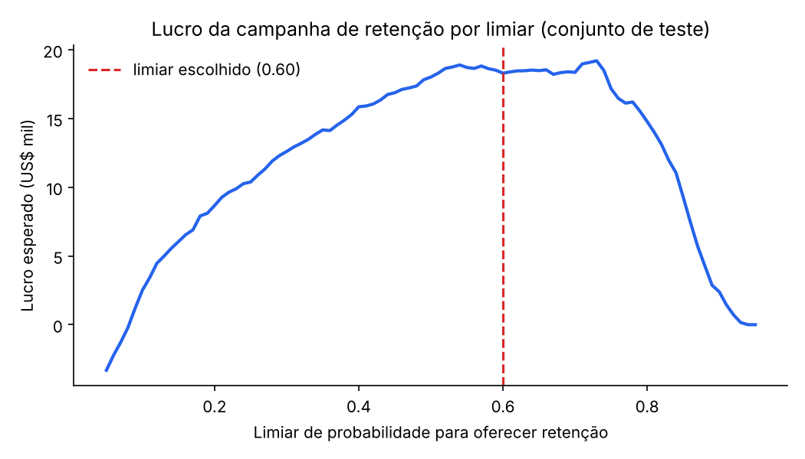
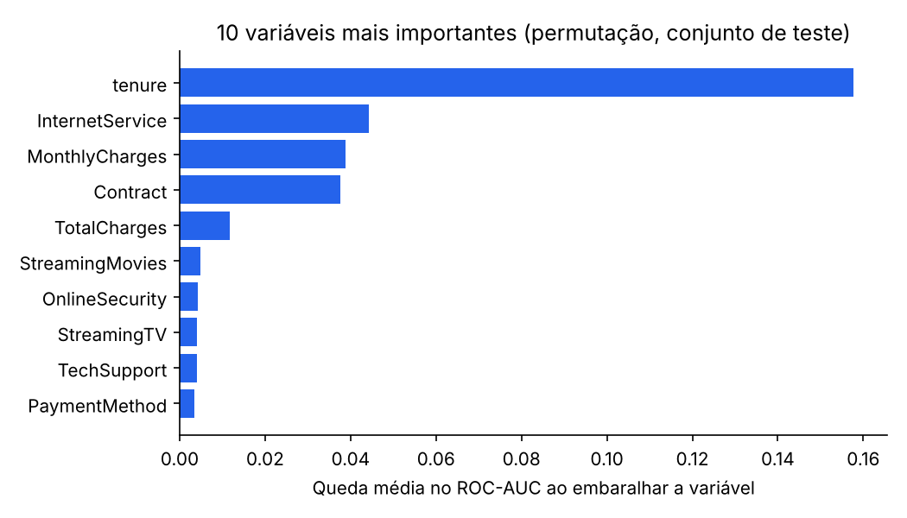

# Previsão de Churn com Otimização por Lucro


Modelo de machine learning que estima a probabilidade de um cliente de telecom cancelar o serviço e decide **quem deve receber uma oferta de retenção**, escolhendo o limiar de decisão que maximiza o lucro da campanha, e não só uma métrica estatística.

Treinado no dataset público **[IBM Telco Customer Churn](https://github.com/IBM/telco-customer-churn-on-icp4d)** (7.043 clientes, 26,5% de cancelamento), o mesmo publicado no [Kaggle](https://www.kaggle.com/datasets/blastchar/telco-customer-churn). O projeto cobre o ciclo completo: limpeza, comparação de modelos com validação cruzada, avaliação honesta em dados de teste, explicabilidade, API REST, testes automatizados, Docker e CI.

## Resultados

| Métrica (conjunto de teste, 1.409 clientes) | Valor |
|---|---|
| ROC-AUC | **0,84** |
| PR-AUC (taxa base de churn: 26,5%) | 0,63 |
| Recall no limiar escolhido | 71% dos clientes que cancelariam são abordados |
| Lucro da campanha guiada pelo modelo | **US$ 18,3 mil** |
| Lucro com o limiar padrão de 0,5 | US$ 18,0 mil |
| Lucro abordando todos os clientes | **prejuízo** de US$ 13,3 mil |

Oferecer desconto para todo mundo **dá prejuízo**: a maioria dos clientes não ia sair, e cada abordagem tem custo. Usar o modelo para escolher quem abordar transforma a campanha em lucro.

Neste dataset, o limiar otimizado (0,60) rende só um pouco mais que o padrão de 0,5, porque o `class_weight="balanced"` já desloca as probabilidades para cima. O valor de calcular o limiar está em não depender da sorte: com outras premissas de custo, o ponto ótimo muda, e a curva abaixo mostra que limiares baixos levam a campanha de volta ao prejuízo.





O tempo de casa (`tenure`) é de longe o fator mais forte, seguido do tipo de internet, do valor mensal e do tipo de contrato. Os dados confirmam: 42,7% dos clientes com contrato mensal cancelam, contra 2,8% dos que têm contrato de dois anos. Gênero praticamente não influencia.

## Decisões técnicas

- **Limiar escolhido pelo negócio, não pelo padrão de 0,5.** Premissas (ajustáveis em `model.py`): cada abordagem custa US$ 50; cada cliente perdido custa 6 meses de receita; a oferta convence 35% de quem ia sair. O limiar que maximiza o lucro é escolhido nas previsões *fora da amostra* do treino (via `cross_val_predict`) para não vazar informação do teste.
- **O modelo simples vence se o complexo não for claramente melhor.** O gradient boosting (ROC-AUC 0,847 na validação cruzada) superou a regressão logística (0,846) por só 0,001. A regra do projeto é só trocar o modelo simples por um mais complexo se o ganho passar de 0,005. Por isso a regressão logística foi escolhida: é mais simples, mais rápida e mais fácil de explicar.
- **Limpeza documentada e testada.** No CSV original, `TotalCharges` vem como texto e fica em branco para os 11 clientes com `tenure = 0`. Eles ainda não pagaram nenhuma fatura, então o total vira 0. Um teste garante isso.
- **Pipeline único do scikit-learn.** Pré-processamento e modelo ficam no mesmo objeto, então a API aplica exatamente as mesmas transformações do treino.
- **Importância por permutação** no conjunto de teste, que mede o impacto real de cada variável na qualidade do modelo.
- **Validação de entrada na API** com Pydantic: valores fora do domínio (como `Contract: "Weekly"`) retornam erro 422 em vez de uma previsão sem sentido.

### Limitações (e próximos passos)

- O dataset é uma amostra pública da IBM sobre uma operadora fictícia da Califórnia, com valores em dólar. As premissas de custo e de sucesso da oferta são hipóteses e deveriam ser medidas com um teste A/B numa empresa real.
- O `class_weight="balanced"` melhora o recall, mas descalibra as probabilidades (Brier 0,17). Uma calibração (`CalibratedClassifierCV`) deixaria as probabilidades mais fiéis.
- Monitorar *data drift* em produção e retreinar periodicamente.

## Notebook no Kaggle

A análise exploratória e o modelo também estão em formato de notebook, pronto para rodar no Kaggle: [`notebooks/churn-telco-lucro.ipynb`](notebooks/churn-telco-lucro.ipynb).

## Como rodar

```bash
git clone https://github.com/juliamunizcarvalh0/previsao-churn.git
cd previsao-churn
python -m venv .venv && source .venv/bin/activate
make install   # dependências
make train     # treina e gera reports/
make test      # roda os testes
make api       # sobe a API em http://localhost:8000/docs
```

Ou com Docker (o modelo é treinado durante o build):

```bash
docker build -t previsao-churn .
docker run -p 8000:8000 previsao-churn
```

### Exemplo de uso da API

```bash
curl -X POST localhost:8000/predict -H "Content-Type: application/json" -d '{
  "gender": "Female", "SeniorCitizen": 0, "Partner": "No", "Dependents": "No",
  "tenure": 2, "PhoneService": "Yes", "MultipleLines": "No",
  "InternetService": "Fiber optic", "OnlineSecurity": "No", "OnlineBackup": "No",
  "DeviceProtection": "No", "TechSupport": "No", "StreamingTV": "Yes",
  "StreamingMovies": "Yes", "Contract": "Month-to-month", "PaperlessBilling": "Yes",
  "PaymentMethod": "Electronic check", "MonthlyCharges": 95.5, "TotalCharges": 191.0
}'
```

```json
{"probabilidade_churn": 0.89, "risco": "alto", "recomendar_oferta_retencao": true}
```

Endpoints: `GET /health`, `POST /predict` e `POST /predict/batch` (até 1.000 clientes).

## Estrutura

```
├── data/Telco-Customer-Churn.csv   # dataset IBM (Apache 2.0)
├── notebooks/                      # notebook do Kaggle
├── src/churn/
│   ├── data.py     # carga e limpeza do dataset
│   ├── model.py    # pipelines, cálculo de lucro e escolha do limiar
│   ├── train.py    # treino, avaliação, gráficos e artefatos
│   └── api.py      # API FastAPI
├── tests/          # testes de dados, modelo e API (pytest)
├── reports/        # métricas e gráficos gerados no treino
├── Dockerfile
└── .github/workflows/ci.yml   # lint + testes + build Docker
```

## Tecnologias

Python · pandas · NumPy · scikit-learn · FastAPI · Pydantic · pytest · Docker · GitHub Actions

## Créditos e licença

Código sob licença MIT. Dataset: *Telco Customer Churn*, publicado pela IBM em [IBM/telco-customer-churn-on-icp4d](https://github.com/IBM/telco-customer-churn-on-icp4d) sob licença Apache 2.0.
